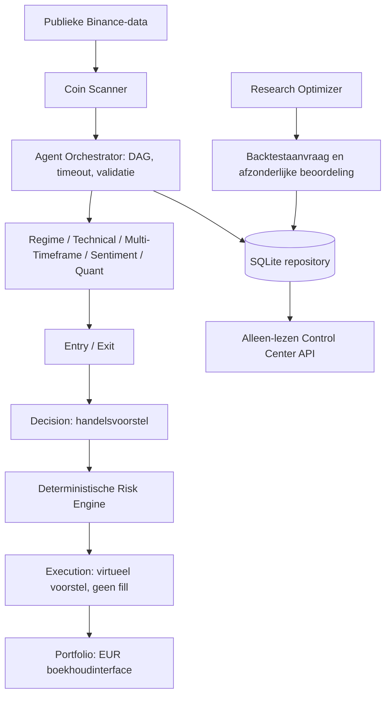
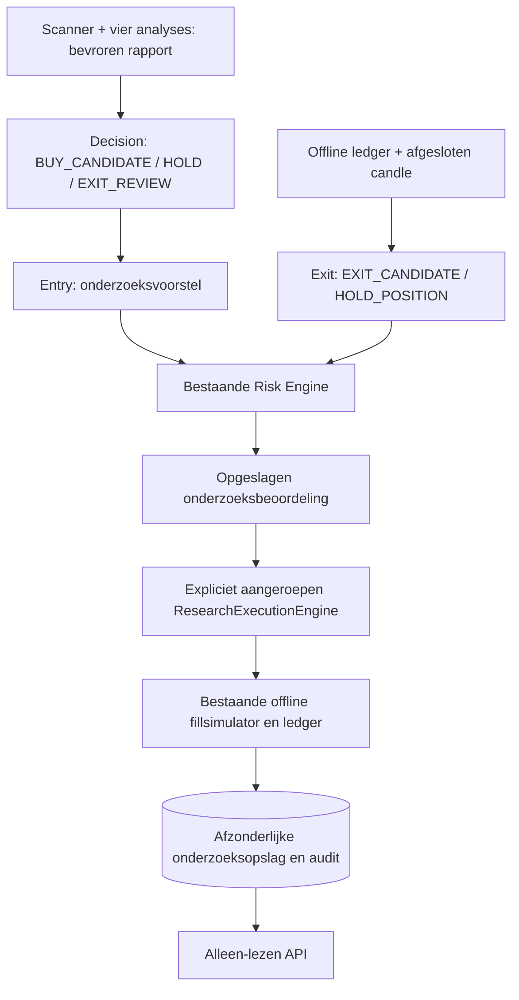
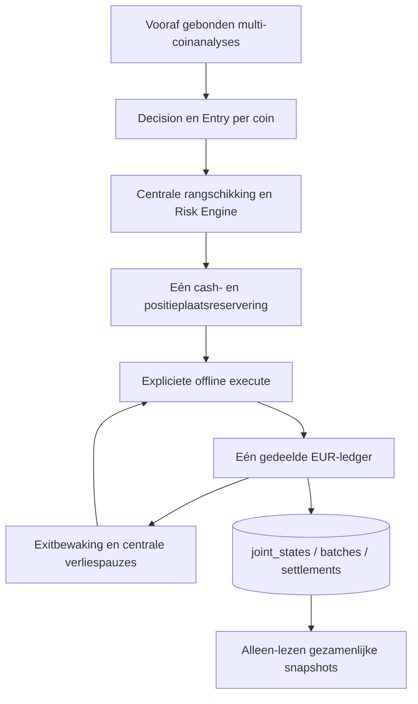

# Architectuur

## De 13 componenten

| Component | Verantwoordelijkheid | Type / fase-1-status |
|---|---|---|
| Coin Scanner | EUR-spotparen filteren op volume, diepte, spread, kwaliteit en historie | Deterministische selectiefunctie |
| Market Regime | Marktregime onderzoeken | Onderzoekscontract |
| Technical Analysis | Indicatoren berekenen | Deterministisch contract |
| Multi-Timeframe | Tijdsframes vergelijken | Deterministisch contract |
| News & Sentiment | Nieuws en sentiment onderzoeken | Onderzoekscontract |
| Quant Research | Toetsbare hypothesen onderzoeken | Onderzoekscontract |
| Entry | Instapvoorwaarden voorstellen | Onderzoekscontract |
| Exit | Uitstapvoorwaarden voorstellen | Onderzoekscontract |
| Decision | Geldige signalen samenvoegen | Deterministisch contract |
| Research Optimizer | Begrensde kandidaten en backtestaanvragen | Python workflow, geen LLM gekoppeld |
| Risk Engine | Harde en operationele grenzen afdwingen | Python implementatie |
| Execution Engine | Gevalideerd virtueel voorstel registreren | Python implementatie, geen fills |
| Portfolio Manager | Gedeeld EUR startsaldo en snapshot | Python basisinterface |

`crypto/agents.py` legt de afhankelijkheden vast; `Agent` en `Message` vormen het
uniforme onderzoekscontract. Concrete strategieën volgen later. Agenten krijgen
kopieën van afhankelijkheidsberichten, geen opslagobject. Dit is een interfacegrens,
geen OS-sandbox voor vijandige Python-code. Asynchrone agents moeten coöperatief zijn;
blokkende/CPU-intensieve workloads vereisen later procesisolatie.

## Gegevens en opslag

Berichten bevatten agent-ID, UUID, munt, UTC-tijd, tijdsframe, brongegevens,
resultaat, onderbouwing, TTL, status en fouten. Pydantic weigert ontbrekende velden,
extra velden en ongeldige combinaties. Resultaten worden bij ontvangst en vóór
gebruik op verval gecontroleerd. SQLite PRIMARY KEY voorkomt hergebruik van
gebeurtenis-ID's over herstarts; taakfouten blokkeren afhankelijke taken.

SQLite bevat afzonderlijke tabellen voor coins, pairs, candles, agents, results,
regimes, hypotheses, strategies, proposals, risk_decisions, orders, positions,
portfolio_history, audit, research_results, errors en periods. Records gebruiken
JSON-payloads en stabiele IDs; ordervoorstel, risicobesluit en audit worden in één
transactie geschreven. De `Storage`-interface is de basis voor een andere adapter;
de orchestrator/execution vereisen daarnaast transacties. Een latere migratielaag
moet typed tabellen, foreign keys tussen domeinrecords en schema-versies toevoegen.
Gebruik voorlopig één applicatieproces en één schrijvende workflow.

## Risico en onderzoeksisolatie

Standaard: 1% trade-risico, 50% exposure, 3% dagverlies, 10% drawdown,
correlatiegrens 0,8 en maximaal 60 seconden oude gegevens. `Limits` configureert
vaste bovengrenzen en lagere operationele limieten afzonderlijk. Een noodstop,
ontbrekende correlatie/marktmetadata, onvoldoende saldo, ongeldige quantisatie of
notional leiden tot afwijzing. Rekenwerk gebruikt Decimal. De risicoschatting
neemt voorlopig 0,1% fee per zijde mee; gaps en slippage zijn niet gemodelleerd.
Correlatie en portefeuillecijfers zijn expliciete inputs van de toekomstige ledger,
geen door een LLM te leveren autorisatie voor uitvoering.

Execution slaat uitsluitend status `proposed` op. Ze reserveert geen saldo en
boekt geen fills: meerdere voorstellen vormen daarom geen uitvoerbare portefeuille.
De portfolio-interface initialiseert €200 EUR. Posities en P&L volgen later.
Er bestaat geen API-route om orders, limieten of strategieën te wijzigen.

De optimizer accepteert alleen parameters binnen meegegeven onderzoeksbereiken.
Overlappende halfopen perioden [start, eind) van dezelfde dataset mogen niet opnieuw
als onafhankelijk bewijs dienen. Dataset-IDs moeten canoniek blijven; later is een
globaal datasetregister met hashes nodig. Goedkeuring vereist reviewer en bewijs,
maar blijft een inactieve kandidaat. Fase 1 bevat geen authenticatie, automatische
bewijsbeoordeling, strategieactivatie of echte backtestberekening.

## Fase-3-onderzoeksworkflow

De vier concrete agents in crypto.analysis gebruiken een gedeelde gevalideerde
AnalysisContext per coin met 15m/1h/4h snapshots. De werkelijke onderzoeks-DAG is:
scanner → technical → regime/multi_timeframe; scanner → sentiment;
scanner + vier agents → CombinedResearchAgent. Dit pad eindigt bij onderzoek,
zonder entry/exit/decision/risk/execution aan te roepen. run_research verzorgt
opslag, eventhergebruik en expliciete historische evaluatietijd. De bestaande
orchestratorstandaard voor actuele berichtvalidatie blijft behouden.
Details en beperkingen staan in PHASE3_REPORT.md.

## Fase-4-onderzoeksinterfaces

QuantResearcher leest bestaande gevalideerde analyseberichten en toetst drie vaste
combinaties. ResearchPlan bindt hypotheses, indicatorparameters, periodes,
kosten/risico en rapportbundels met een SHA-256-ID. OfflineResearchOptimizer
registreert dat plan en inzage in deelperioden via research_plans en
research_exposures; selecties en onbekende prestatievelden gaan naar bestaande
research_results. Er is geen verbinding naar productieconfiguraties of execution.
De oudere ResearchOptimizer-interface blijft bestaan. Zie RESEARCH_PROTOCOL.md
voor de vooraf vastgelegde hypotheses en PHASE4_REPORT.md voor de beperking tot
onderzoeksinterfaces zolang een gevalideerde fillsimulator ontbreekt.

## Fase-4B-simulatiepad

BacktestRunner registreert een SimulationProtocol naast het onveranderde ResearchPlan.
De bestaande optimizer en QuantResearcher controleren de onderzoeksselecties.
OfflineLedger en FillCosts verwerken uitsluitend historische simulatietransacties.
Elke coin/hypothese heeft een afzonderlijke EUR-ledger, maximaal één positie en
€200 startkapitaal. simulation_protocols en backtest_runs staan los van de
papertrading-tabellen; de API biedt alleen leesroutes. De onafhankelijke test
blijft gesloten zonder vooraf vastgelegde expliciete protocolautorisatie.
Zie PHASE4B_REPORT.md voor filters, kosten, tijdconventies en modelbeperkingen.

## Fase-5-onderzoeksworkflow

De bovenstaande fase-1-catalogus blijft als bestaand contract behouden. Het nieuwe
onderzoeks-DAG gebruikt de gevalideerde fase-3-snapshot als invoer:

ResearchTradingSession bindt ResearchPlan, DecisionPolicy, filters, rapporthashes
 en candlehashes vóór evaluatie. Alleen kleine ontwikkelperioden zijn toegestaan;
validatie en onafhankelijke test blijven gesloten. evaluate maakt geen orders.
De onderzoeks-Execution-adapter erft het bestaande Execution-contract maar blokkeert
propose; expliciete simulate vereist een geregistreerd risicobesluit en hercontrole.
De Risk Engine heeft een optionele historische evaluatieklok en een bezitbegrensde
exitcontrole; de bestaande paper-route kan de onderzoeks-evaluatieklok niet gebruiken.
Elke open positie wordt op alle opeenvolgende 15m-candles gecontroleerd.

Nieuwe tabellen decision_protocols, trade_decisions, research_trade_reviews,
research_fills en research_ledger_states zijn gescheiden van papertrading. De laatste
bewaart ook HOLD-waarderingen en herstartbare ledgerstaat. De API heeft uitsluitend
leesroutes voor beslissingen, beoordelingen en onderzoeksfills. Zie PHASE5_REPORT.md
voor de regels, exitprioriteit, onbekende nieuwsdata en modelbeperkingen.

## Fase-6A-gezamenlijke portefeuillemode

`JointPortfolio` in crypto.joint_portfolio is een expliciete nieuwe mode. Eén
OfflineLedger met eenmaal €200 wordt gedeeld door de volledige ResearchPlan-watchlist;
er worden geen coin-sessies met afzonderlijk startkapitaal gemaakt. Decision/Entry
krijgen kopieën van die balans. De bestaande centrale RiskEngine en fase-5-controles
beoordelen voorstellen vóór reservering en opnieuw vóór expliciete uitvoering.
De bestaande fillsimulator en andere portefeuillemodes blijven ongewijzigd.

JointPolicy staat uitsluitend één open positie toe. Prioriteit is scannerscore
dalend, daarna een vastgelegde UTC-rotatie bij gelijke scores. Invoer- en aankomstvolgorde
bepalen niet de selectie. Alle afwijzingen en hun onderbouwing worden bewaard.
BEGIN IMMEDIATE, state-revisies en unieke batch-/settlement-ID's beschermen tegen
dubbele reserveringen, dubbele fills en verloren wijzigingen tussen verbindingen.

joint_protocols bindt plan, beleid, filters en datahashes. joint_states bewaart de
volledige ledger, reservering en historische waardering. joint_batches bewaart
alle kandidaten; joint_settlements bewaart fills, afwijzingen en vervallen reserveringen.
De nieuwe `/joint-portfolios`-route staat los van de oude `/portfolio`-interface.
Alleen kleine ontwikkeltests zijn toegestaan; de onafhankelijke test blijft gesloten.
Zie PHASE6A_REPORT.md voor prioriteit, uitvoeringsaannames en resterende beperkingen.
